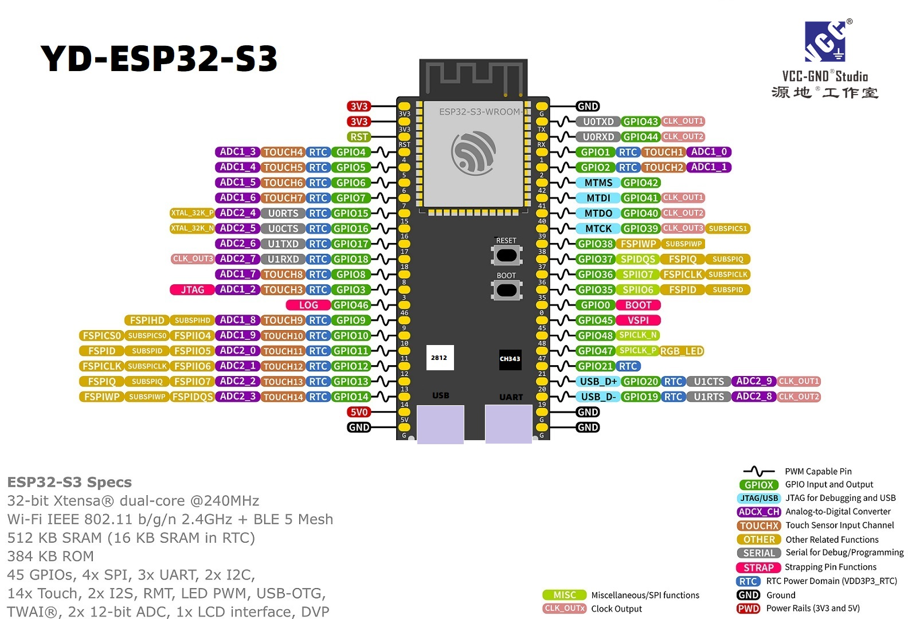

# YD-ESP32-S3 排针表（P1 / P2）

上图来自 VCC-GND 官方仓库 `IMG/img11.jpg`。下表序号与原理图 `schematic_v1.4.pdf` 一致。类型：P=电源，G=地，I/O/T=输入输出。

## P1

| 序号 | 名称 | 类型 | 功能 |
|---:|---|---|---|
| 1 | 3V3 | P | 3.3 V |
| 2 | 3V3 | P | 3.3 V |
| 3 | RST | I | EN |
| 4 | 4 | I/O/T | GPIO4, TOUCH4, ADC1_CH3 |
| 5 | 5 | I/O/T | GPIO5, TOUCH5, ADC1_CH4 |
| 6 | 6 | I/O/T | GPIO6, TOUCH6, ADC1_CH5 |
| 7 | 7 | I/O/T | GPIO7, TOUCH7, ADC1_CH6 |
| 8 | 15 | I/O/T | GPIO15, U0RTS, ADC2_CH4, XTAL_32K_P |
| 9 | 16 | I/O/T | GPIO16, U0CTS, ADC2_CH5, XTAL_32K_N |
| 10 | 17 | I/O/T | GPIO17, U1TXD, ADC2_CH6 |
| 11 | 18 | I/O/T | GPIO18, U1RXD, ADC2_CH7 |
| 12 | 8 | I/O/T | GPIO8, TOUCH8, ADC1_CH7 |
| 13 | 3 | I/O/T | GPIO3, TOUCH3, ADC1_CH2 |
| 14 | 46 | I/O/T | GPIO46 |
| 15 | 9 | I/O/T | GPIO9, TOUCH9, ADC1_CH8 |
| 16 | 10 | I/O/T | GPIO10, TOUCH10, ADC1_CH9 |
| 17 | 11 | I/O/T | GPIO11, TOUCH11, ADC2_CH0 |
| 18 | 12 | I/O/T | GPIO12, TOUCH12, ADC2_CH1 |
| 19 | 13 | I/O/T | GPIO13, TOUCH13, ADC2_CH2 |
| 20 | 14 | I/O/T | GPIO14, TOUCH14, ADC2_CH3 |
| 21 | 5V | P | 5 V |
| 22 | G | G | GND |

## P2

| 序号 | 名称 | 类型 | 功能 |
|---:|---|---|---|
| 1 | G | G | GND |
| 2 | TX | I/O/T | U0TXD, GPIO43 |
| 3 | RX | I/O/T | U0RXD, GPIO44 |
| 4 | 1 | I/O/T | GPIO1, TOUCH1, ADC1_CH0 |
| 5 | 2 | I/O/T | GPIO2, TOUCH2, ADC1_CH1 |
| 6 | 42 | I/O/T | MTMS, GPIO42 |
| 7 | 41 | I/O/T | MTDI, GPIO41 |
| 8 | 40 | I/O/T | MTDO, GPIO40 |
| 9 | 39 | I/O/T | MTCK, GPIO39 |
| 10 | 38 | I/O/T | GPIO38 |
| 11 | 37 | I/O/T | GPIO37（常内部 Flash/PSRAM，**外部勿用**）|
| 12 | 36 | I/O/T | GPIO36（同上）|
| 13 | 35 | I/O/T | GPIO35（同上）|
| 14 | 0 | I/O/T | GPIO0 (BOOT) |
| 15 | 45 | I/O/T | GPIO45 |
| 16 | 48 | I/O/T | GPIO48, **RGB LED** |
| 17 | 47 | I/O/T | GPIO47 |
| 18 | 21 | I/O/T | GPIO21 |
| 19 | 20 | I/O/T | GPIO20, USB_D+ |
| 20 | 19 | I/O/T | GPIO19, USB_D- |
| 21 | G | G | GND |
| 22 | G | G | GND |

来源：VCC-GND YD-ESP32-S3 README。
