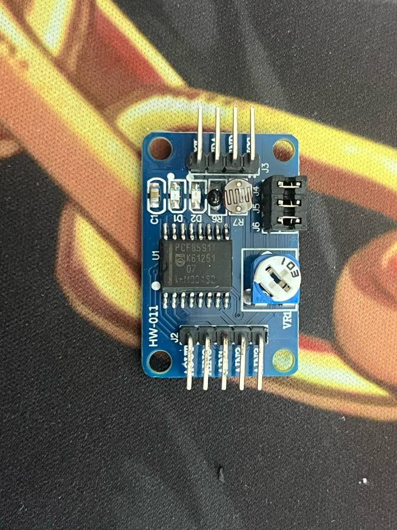
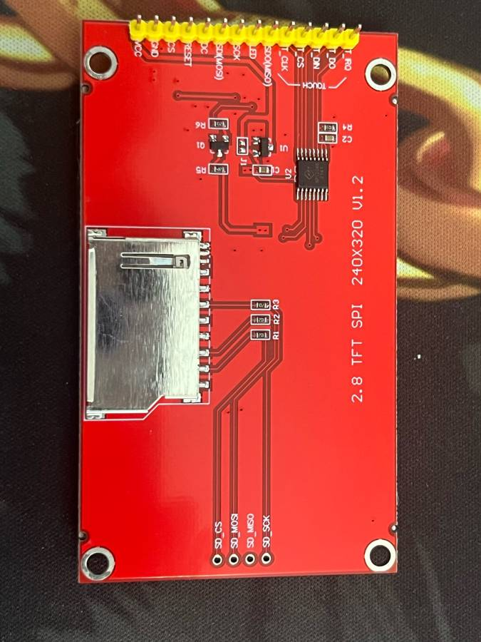
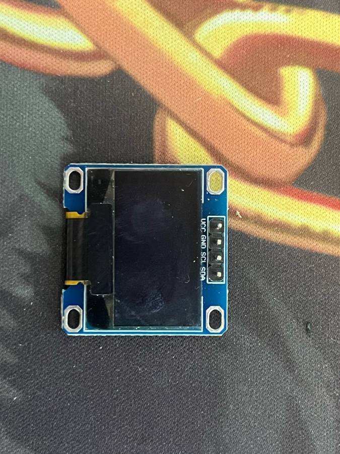
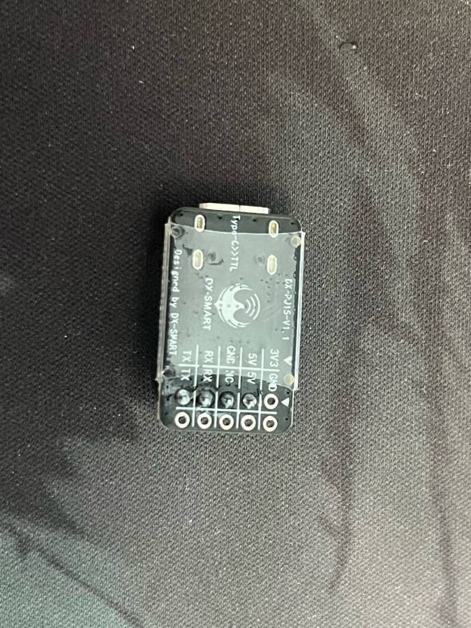
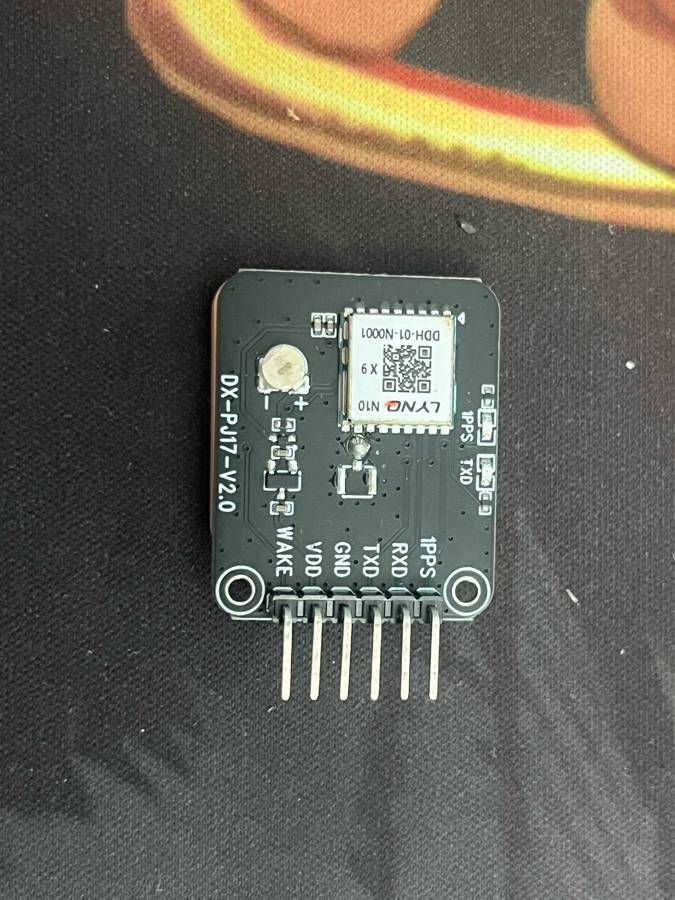
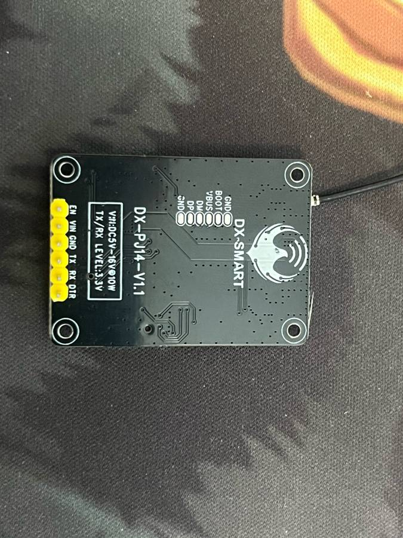

# 小模块资料（配合 YD-ESP32-S3 使用）

常见淘宝小模块的引脚、电平、接线和库。照片是实物（已压缩）。标「待确认」的条目是照片和公开资料都没法确定的，以实测或卖家资料为准。

## 模块简报

| 目录 | 模块 | 接口 | 主芯片 | 用途 |
|---|---|---|---|---|
| [max485-rs485](max485-rs485/README.md) | TTL 转 RS-485 | UART | MAX485 | TTL/UART ↔ RS-485 总线转换，远距离/多节点串口通信 |
| [pcf8591-hw011](pcf8591-hw011/README.md) | AD/DA 模块 HW-011 | I2C | PCF8591 | I2C 8 位 AD/DA，可接光敏/热敏/电位器或外部模拟量 |
| [w5500-ethernet](w5500-ethernet/README.md) | 以太网模块 | SPI | W5500 | SPI 硬核 TCP/IP 以太网，给 MCU 加有线网口 |
| [tft-2.8-ili9341-spi](tft-2.8-ili9341-spi/README.md) | 2.8" TFT 240×320 + 电阻触摸 + SD 卡 | SPI | ILI9341（待确认）+ XPT2046 类 | 2.8 寸 240×320 SPI 彩屏+电阻触摸+SD |
| [oled-0.96-ssd1306-i2c](oled-0.96-ssd1306-i2c/README.md) | 0.96" OLED 128×64 | I2C | SSD1306（待确认）| 0.96 寸 128×64 I2C OLED，调试状态显示 |
| [usb-ttl-dx-pj15](usb-ttl-dx-pj15/README.md) | Type-C 转 TTL 串口（DX-SMART DX-PJ15）| USB / UART | 桥接芯片待确认 | USB-C 转 TTL 串口调试下载线 |
| [gnss-dx-pj17-lyno-n10](gnss-dx-pj17-lyno-n10/README.md) | GNSS 定位（DX-PJ17 / DX-GP10-A）| UART + 1PPS | DX-GP10-A（内置陶瓷天线）| DX-GP10-A，GPS+BDS+GLONASS，UART 输出 NMEA |
| [mcp2515-can](mcp2515-can/README.md) | CAN 总线 | SPI | MCP2515 + TJA1050（待确认）| SPI CAN 控制器+收发，接车载/机器人 CAN 总线 |
| [4g-cat1-dx-pj14](4g-cat1-dx-pj14/README.md) | 4G Cat.1（DX-PJ14 / DX-CT511-A）| UART | DX-CT511-A | 4G Cat.1 上网，TCP/UDP/HTTP/MQTT，无板载 GNSS |

## 实物图

压缩后的实物照片，显示宽度 180px。点图片进入对应模块说明，顺序与上面的简报一致。

| | | |
|:---:|:---:|:---:|
|  [TTL 转 RS-485](max485-rs485/README.md) |  [AD/DA 模块 HW-011](pcf8591-hw011/README.md) |  [以太网模块](w5500-ethernet/README.md) |
|  [2.8" TFT](tft-2.8-ili9341-spi/README.md) |  [0.96" OLED](oled-0.96-ssd1306-i2c/README.md) |  [Type-C 转 TTL](usb-ttl-dx-pj15/README.md) |
|  [GNSS DX-GP10-A](gnss-dx-pj17-lyno-n10/README.md) |  [CAN 总线](mcp2515-can/README.md) |  [4G DX-CT511-A](4g-cat1-dx-pj14/README.md) |

## 全部模块同时接到 YD-ESP32-S3 的推荐 GPIO 分配

原则：避开 GPIO0/3/45/46（strapping 引脚）、GPIO19/20（USB）、GPIO43/44（UART0 下载口）、GPIO35–37（N16R8 的八线 PSRAM 占用）、GPIO48（板载 RGB）。引脚位置见 [`boards/yd-esp32-s3/00-essential/PINOUT.md`](../boards/yd-esp32-s3/00-essential/PINOUT.md)。

| 功能 | GPIO | 用于 |
|---|---|---|
| I2C SDA / SCL | 8 / 9 | OLED、PCF8591（共用一条总线，地址不冲突）|
| SPI SCK / MOSI / MISO | 12 / 11 / 13 | TFT、触摸、SD 卡、W5500 共用 SPI2(FSPI) |
| TFT CS / DC / RST / LED | 10 / 14 / 21 / 47 | TFT |
| 触摸 T_CS / T_IRQ | 1 / 2 | XPT2046 |
| SD_CS | 42 | TFT 背面 SD 卡座 |
| W5500 CS / INT / RST | 41 / 40 / 39 | W5500 |
| UART1 TX / RX | 17 / 18 | MAX485 DI / RO |
| RS-485 DE+RE | 16 | MAX485 收发方向 |
| MCP2515 CS / INT | 38 / 15 | CAN 模块（共用 SPI2，SO/INT 要分压）|
| UART2 TX / RX | 4 / 5 | GNSS（模块 RXD / TXD）|
| GNSS 1PPS | 47（可选）| 要用的话 TFT 背光改接 3V3，把 GPIO47 让出来 |
| 4G TX / RX | 7 / 6 | UART0 重映射过来（日志改走 USB-CDC），或者分时借用 UART1 |

可用的空闲 GPIO 到这里基本用完了。DX-PJ15 USB 转串口模块不占 GPIO。

注：GPIO39–42 是 JTAG 引脚，用 USB-JTAG（内置）调试时不受影响；如果要外接 JTAG 调试器，需要重新分配这几个脚（GPIO4–7 现在已经给了 GNSS 和 4G）。W5500 跑高速 SPI 时，也可以单独开一条 SPI3 给它，减少和屏幕抢总线。

**通用电平提醒**：ESP32-S3 的 GPIO 是 3.3 V，**不耐 5 V**。下面凡是模块用 5 V 供电的，都要看它的输出引脚会不会把 5 V 送进 ESP32。
