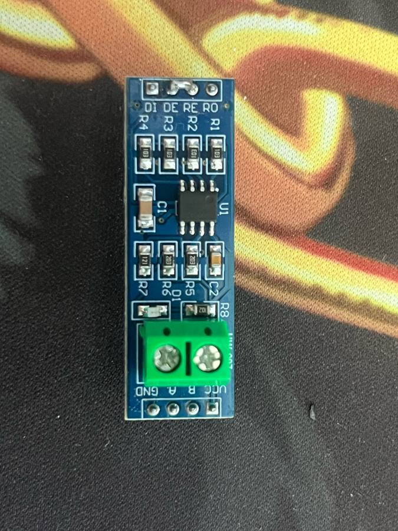

# MAX485 TTL 转 RS-485 模块

蓝色小板，主芯片 MAX485（SOIC-8），一侧 4 针排针 `RO RE DE DI`，另一侧 4 针 `VCC B A GND` 和绿色两位接线端子（A、B）。半双工，用于 Modbus RTU、RS-485 总线设备。

## 引脚

| 引脚 | 方向（相对模块）| 说明 |
|---|---|---|
| RO | 输出 | 接收数据输出 → MCU RX |
| RE | 输入 | 接收使能，**低电平有效** |
| DE | 输入 | 发送使能，**高电平有效** |
| DI | 输入 | 发送数据输入 ← MCU TX |
| VCC | 电源 | 5 V（MAX485 本身额定 5 V ±5%）|
| GND | 地 | |
| A / B | 总线 | RS-485 差分线，A 接 A、B 接 B（不同厂家 A/B 命名可能相反，不通就对调）|

RE 和 DE 一般短接在一起，用一个 GPIO 控制：高=发送，低=接收。

## 电气与注意

- MAX485 规格为 5 V 供电；数据手册的接收器输出高电平接近 VCC，所以 **5 V 供电时 RO 会输出约 5 V，直接接 ESP32-S3 有风险**。做法任选其一：
  1. RO 串电阻分压（如 2 kΩ/3.3 kΩ）后接 GPIO18；
  2. 模块 VCC 接 3.3 V：很多人这么用且能工作，但**超出 MAX485 规格**（待确认，短线低速勉强可以，不建议长期）；
  3. 换 3.3 V 芯片（MAX3485、SN65HVD3082E 等）的模块。
- 板上贴片电阻：R7 疑似 120 Ω 终端电阻（丝印待确认，常见标记 `121`），总线两端设备需要终端，中间节点应焊掉；另有 A 上拉/B 下拉偏置电阻（阻值待确认）。
- 最大速率按数据手册约 2.5 Mbps；Modbus 常用 9600–115200。

## 接 YD-ESP32-S3

| 模块 | ESP32-S3 |
|---|---|
| DI | GPIO17（UART1 TX）|
| RO | GPIO18（UART1 RX，建议经分压）|
| DE + RE | GPIO16 |
| VCC | 5V（见上文电平注意）|
| GND | G |

## 库

- Arduino：`HardwareSerial` + [ModbusMaster](https://github.com/4-20ma/ModbusMaster)（`preTransmission`/`postTransmission` 回调里切 GPIO16）。
- ESP-IDF：UART 驱动自带 RS-485 半双工模式 `uart_set_mode(UART_NUM_1, UART_MODE_RS485_HALF_DUPLEX)`，把 RTS 引脚设为 GPIO16 即可自动切方向。

## 资料

- MAX485 数据手册（ADI 官方）：https://www.analog.com/media/en/technical-documentation/data-sheets/MAX1487-MAX491.pdf （本次整理环境访问被拦截，链接待浏览器确认）
- 3.3 V 替代芯片示例 SN65HVD3082E（TI）：https://www.ti.com/lit/ds/symlink/sn65hvd3082e.pdf
