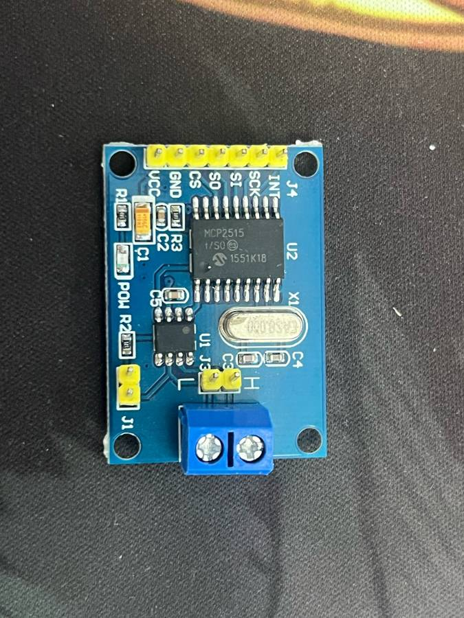

# MCP2515 CAN 总线模块（SPI）

蓝色小板：Microchip MCP2515（SPI 接口的 CAN 2.0B 控制器）+ CAN 收发器 U1（常见是 NXP TJA1050，**丝印待确认**）+ 晶振（常见 8 MHz，**丝印待确认**，部分批次是 16 MHz）。J1 是 120 Ω 终端电阻跳线，J3 是 CAN_H / CAN_L 排针，旁边还有接线端子。

## 引脚

| 引脚 | 说明 |
|---|---|
| VCC | 5 V（MCP2515 和收发器同一路供电）|
| GND | 地 |
| CS | SPI 片选 |
| SO | SPI MISO（MCP2515 输出）|
| SI | SPI MOSI |
| SCK | SPI 时钟 |
| INT | 中断输出，低有效 |
| H / L | CAN_H / CAN_L |

## 电气（重点看）

- TJA1050 需要 5 V 供电（规格 4.75–5.25 V），这块板上 MCP2515 和 TJA1050 共用 VCC。**VCC 接 5 V 时，MCP2515 的 SO、INT 输出约 5 V，会超出 ESP32-S3 的 3.3 V 耐压。**
  可选做法：
  1. SO 和 INT 各串分压（例如 2 kΩ / 3.3 kΩ）后再接 ESP32。SI、SCK、CS 是 ESP32 输出给 5 V 器件，3.3 V 高电平一般能被识别（MCP2515 在 5 V 下 VIH 门限要按数据手册核对，待确认）。
  2. 改板：给 MCP2515 单独供 3.3 V、TJA1050 保持 5 V（要割线，网上有教程）。
  3. **不用这块板**：ESP32-S3 自带 CAN 控制器（TWAI），外接一个 3.3 V 收发器（如 SN65HVD230）就行，少一颗 SPI 芯片，更推荐。
- MCP2515 SPI 支持模式 0 和模式 3，最高 10 MHz。
- 库里的晶振参数必须和板上的晶振一致（`MCP_8MHZ` 或 `MCP_16MHZ`），否则波特率不对、收不到数据。
- J1 跳线：模块在总线两端时插上，在中间时拔掉。

## 接 YD-ESP32-S3（和 TFT、W5500 共用 SPI2）

| 模块 | ESP32-S3 |
|---|---|
| SCK | GPIO12 |
| SI | GPIO11 |
| SO | GPIO13（经分压，见上文）|
| CS | GPIO38 |
| INT | GPIO15（经分压）|
| VCC / GND | 5V / G |

## 库

- Arduino：[autowp/arduino-mcp2515](https://github.com/autowp/arduino-mcp2515)，或 [MCP_CAN_lib](https://github.com/coryjfowler/MCP_CAN_lib)（`CAN.begin(MCP_ANY, CAN_500KBPS, MCP_8MHZ)`）。
- ESP-IDF：没有官方 MCP2515 驱动，要用第三方组件；更推荐直接用原生 [TWAI 驱动](https://docs.espressif.com/projects/esp-idf/zh_CN/latest/esp32s3/api-reference/peripherals/twai.html)，外接 3.3 V 收发器。

## 资料

- MCP2515 数据手册（Microchip 官方）：https://ww1.microchip.com/downloads/en/DeviceDoc/MCP2515-Family-Data-Sheet-DS20001801K.pdf
- TJA1050 数据手册（NXP，已停产）：原官方链接 `https://www.nxp.com/docs/en/data-sheet/TJA1050.pdf` 目前返回 404，待补。
