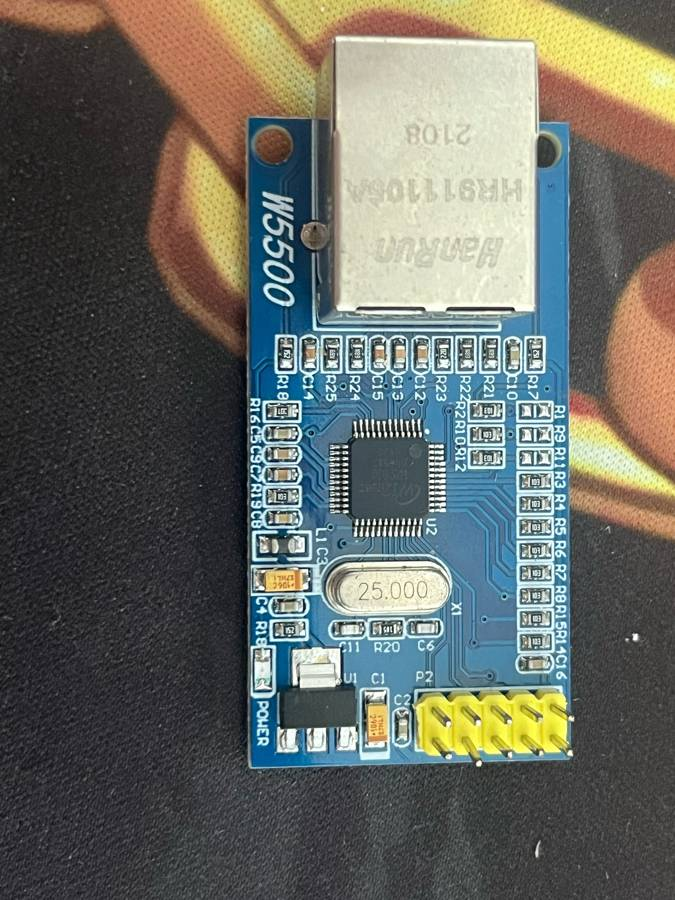

# W5500 以太网模块

WIZnet W5500 硬件 TCP/IP 芯片（内建 8 个 Socket、10/100 MAC+PHY），RJ45 用 HanRun HR911105A（带变压器和指示灯），25 MHz 晶振，板载 3.3 V LDO，2×5 排针 P2。

## 引脚（2×5 排针，具体排位以板上丝印为准）

| 信号 | 说明 |
|---|---|
| 3.3V / 5V | 供电二选一（5V 经板载 LDO 降压）|
| GND | 地 |
| SCLK / MOSI / MISO / SCS | SPI |
| INT | 中断输出，低有效 |
| RST | 复位，低有效 |
| NC | 部分板子有 |

## 电气

- W5500 IO 为 3.3 V，输入耐 5 V（数据手册标注 5V tolerant），输出 3.3 V，可直接接 ESP32-S3。
- SPI 模式 0/3，数据手册标称最高 80 MHz；ESP32-S3 杜邦线连接建议 ≤20 MHz。
- 功耗约 130 mA 级（100M 链接时），**3.3V 脚别从 USB-TTL 小电流口取电**。

## 接 YD-ESP32-S3

| 模块 | ESP32-S3 |
|---|---|
| SCLK | GPIO12 |
| MOSI | GPIO11 |
| MISO | GPIO13 |
| SCS | GPIO41 |
| INT | GPIO40 |
| RST | GPIO39 |
| 3.3V / GND | 3V3 / G |

## 库

- Arduino：[WIZnet Ethernet 库](https://github.com/WIZnet-ArduinoEthernet/Ethernet)（`Ethernet.init(41)` 指定 CS）；Arduino-ESP32 3.x 也有原生 `ETH.h` 支持 W5500（`ETH.begin(ETH_PHY_W5500, ...)`），可接入 lwIP。
- ESP-IDF：`esp_eth` 自带 W5500 SPI 驱动，见 [以太网 API](https://docs.espressif.com/projects/esp-idf/zh_CN/latest/esp32s3/api-reference/network/esp_eth.html)（menuconfig 开 `ETH_SPI_ETHERNET_W5500`）。

## 资料

- W5500 文档与数据手册（WIZnet 官方）：https://docs.wiznet.io/Product/Chip/Ethernet/W5500
- HR911105A 数据手册：待补（HanRun 官网未找到稳定直链）。
